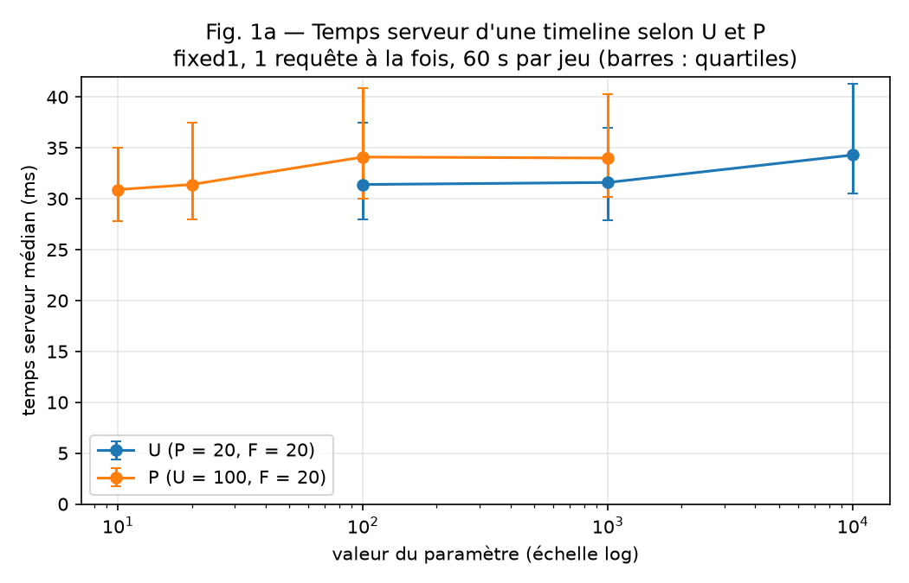
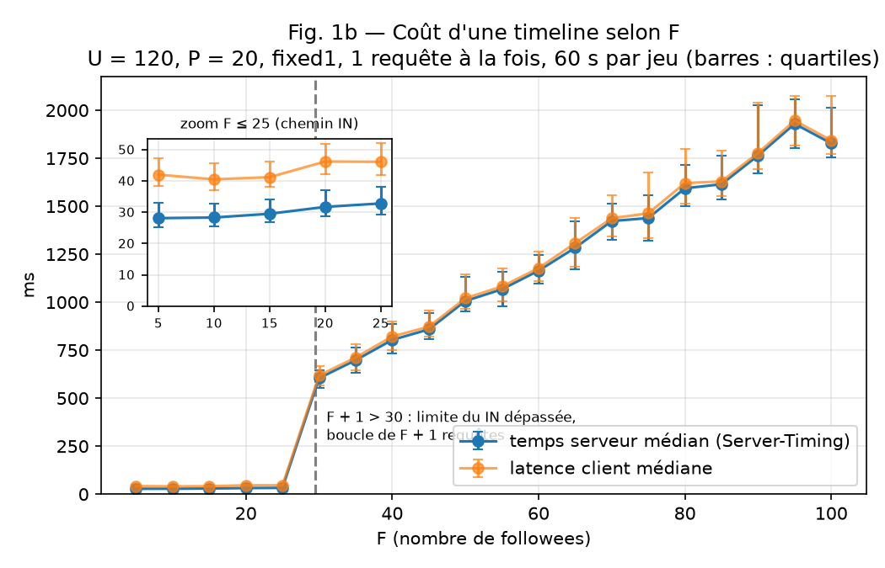

# TinyInsta passe-t-elle à l'échelle ? — Benchmark 2026

Rapport du projet Données massives et Cloud. Sujet : [SUJET.md](SUJET.md). README d'origine du dépôt : [README_original.md](README_original.md).

## 1. Montage
- Projet GCP : `tinyinsta-2026-511514`, région App Engine : `europe-west`
- Application : https://tinyinsta-2026-511514.ew.r.appspot.com (version par défaut `20261106t175435`, F1, autoscaling ≤ 10)
- Base : Firestore en mode Datastore, `concurrencyMode = PESSIMISTIC`, index `Post(author ASC, created DESC)`
- Jeux de données : générés du 06/11 au 08/11/2026 avec `bench/seed_exact.py`, vérifiés par `bench/check_datasets.py` (27/27 exacts)
- Client (seed et charge) : Cloud Shell — Python 3.12, locust 2.46.7, google-cloud-datastore 2.19.0
- Versions de mesure : *(à compléter : fixed1, fixed2, fixed4, dates)*

## 2. Résultats

### Partie 1 — Coût d'une requête

#### Hypothèse

Avant de mesurer, je regarde ce que fait vraiment une timeline dans `get_timeline` (`main.py`, L38-73).

**Ce que fait le code.** Trois étapes :
1. un lookup par clé de l'utilisateur (L43) pour récupérer sa liste `follows` ;
2. l'ajout de l'utilisateur lui-même à cette liste (L47), soit F + 1 auteurs ;
3. une requête `author IN (...) ORDER BY created DESC LIMIT 20` (L61-64), servie par l'index composite `Post(author, created DESC)`.

Le code prévoit aussi une version GQL (L52-56), mais elle ne tourne jamais : `datastore.Client` n'a pas de méthode `gql` (vérifié). Et il y a un piège : si la requête `IN` échoue, l'erreur est ignorée (L65) et le code fait une boucle d'une requête par auteur (L66-72). Or Datastore accepte au plus 30 valeurs dans un `IN`. J'ai testé : 30 passe, 31 renvoie `400 IN supports up to 30 values`. Dès F = 30, l'application change donc de chemin sans rien dire, et répond toujours 200.

**U et P : je m'attends à un temps constant.**
Datastore range ses données par plages de clés triées (*range partitioning*). Dans l'index, les posts d'un même auteur sont côte à côte, du plus récent au plus ancien. Pour avoir ses 20 derniers posts, il suffit d'aller au début de sa plage et de lire 20 entrées : c'est la *range query* avec `ORDER BY … LIMIT` que le cours décrit comme naturelle en range partitioning. Le lookup de L43 est un accès par clé exacte (*point lookup*). Ni le nombre total d'utilisateurs (U), ni les posts plus anciens (P) n'entrent en jeu. C'est toute la différence avec le *Seq Scan* + *Sort* de PostgreSQL vu en cours : ici, on fait toujours l'équivalent d'un *Index Scan*.

**F : je m'attends à ce que ça ne passe pas à l'échelle.**
Chaque auteur suivi est une plage différente, potentiellement sur un *shard* différent. La requête devient un *scatter/gather* sur F + 1 plages, suivi d'une fusion des résultats.
- F ≤ 25 : une seule requête `IN`, légère hausse avec F ;
- F = 30 : un saut, le code bascule sur la boucle ;
- F ≥ 30 : F + 1 allers-retours successifs vers Datastore. Le temps devrait croître à peu près linéairement avec F.

Petit calcul de ce que coûte une timeline :

| Cas | Lookups | Requêtes Datastore | Posts renvoyés (max) |
|---|---|---|---|
| U ou P quelconque (F = 20) | 1 | 1 | 20 |
| F = 25 | 1 | 1 | 20 |
| F = 30 | 1 | 31 | 620 |
| F = 100 | 1 | 101 | 2 020 |

**Latence client.** `Server-Timing` ne chronomètre que `get_timeline` (L139-141). Tout le reste s'ajoute côté client : JSON, Flask, load balancer de Google, réseau jusqu'à Cloud Shell. Comme ça ne dépend ni de U, ni de P, ni de F, l'écart entre latence client et temps serveur devrait rester à peu près constant.

**En résumé :** ça devrait passer à l'échelle en U et en P grâce à l'index, mais pas en F, à cause du `IN` limité à 30 et de la boucle de secours. Comme le dit le cours : *« it scales if the data access scales »*.

#### Protocole
- Version `fixed1` : 1 instance B1 en manual scaling (`./deploy_fixed.sh 1`), donc sans autoscaling.
- Locust en boucle fermée avec `-u 1` : une seule requête à la fois, la suivante part dès la réponse reçue.
- 26 jeux : `u100`, `base`, `u10000` (facteur U), `p10`, `p100`, `p1000` (facteur P, avec U = 100), `f05` … `f100` (facteur F, avec U = 120).
- 60 s par jeu. Avant de mesurer, le script attend que l'instance réponde (10 réponses 200 d'affilée avec `X-Instance`), puis fait une chauffe de 20 s non utilisée. Sans cette attente, j'ai observé des 500 pendant les ~7 s de démarrage de l'instance (`raw/incidents/`).
- Ordre des jeux mélangé (graine 42, voir `raw/part1/order.txt`), avec `base` mesuré au début et à la fin pour détecter une dérive.
- Indicateurs : médiane de `SERVER_MS` (en-tête `Server-Timing`) et de `LATENCY_MS` sur les réponses 200, quartiles en barres d'erreur, nombre d'instances distinctes dans `X-Instance`.
- Mesures du 13/11/2026, de 13:29 à 13:57 UTC, depuis Cloud Shell. Commandes : `bench/run_part1.sh` (mesures), `python bench/make_figures.py` (figures et CSV).

#### Figures

Valeurs tracées : [`figures/fig1a.csv`](figures/fig1a.csv), [`figures/fig1b.csv`](figures/fig1b.csv).

#### Interprétation

**Les mesures sont fiables.** Les 27 runs ont été servis par une seule instance, sans aucun échec (100 % de réponses 200). `base` donne 31,7 ms au début et 31,4 ms à la fin, à 27 minutes d'écart : l'ordre des runs n'a pas biaisé les résultats.

**U et P : hypothèse confirmée.** Avec 100 fois plus d'utilisateurs (U = 100 → 10 000), le temps serveur passe de 31,4 à 34,3 ms. Avec 100 fois plus de posts par utilisateur (P = 10 → 1 000), il passe de 30,9 à 34,0 ms. Ces écarts de 3 ms restent dans les barres d'erreur : le temps est constant. L'index `(author, created DESC)` fait que la requête ne lit que le début de la plage de chaque auteur, quelle que soit la taille de la base.

**F : hypothèse confirmée, avec les trois régimes prévus.**
- F = 5 → 25 (chemin `IN`) : 28,1 → 32,8 ms, une légère hausse.
- F = 25 → 30 : 32,8 → 604 ms, un saut de ×18. C'est la bascule silencieuse sur la boucle quand le `IN` dépasse 30 valeurs.
- F = 30 → 100 : 604 → 1 828 ms, une croissance linéaire. En divisant par le nombre de requêtes, on trouve 604 / 31 ≈ 19,5 ms et 1 828 / 101 ≈ 18,1 ms : chaque requête de la boucle coûte un aller-retour d'environ 18 ms vers Datastore. Le temps d'une timeline suit donc à peu près (F + 1) × 18 ms.

Ce n'est pas Datastore qui ne passe pas à l'échelle ici, mais la façon dont l'application l'interroge : une requête par auteur, en série.

**Part du réseau.** L'écart entre latence client et temps serveur reste autour de 14 ms quel que soit le jeu (13,8 ms pour `base`, 15,2 ms pour `f100`). Il pèse environ 30 % de la latence pour `base`, mais moins de 1 % pour F = 100. Ces 14 ms ne sont pas que du réseau : ils incluent aussi la sérialisation JSON, Flask/gunicorn et le load balancer de Google.

**Lectures Datastore et coût de 1 million de timelines.** Une timeline lit 1 entité `User` (lookup), puis les posts renvoyés : 20 avec le `IN`, et 20 × (F + 1) avec la boucle, puisque chaque auteur renvoie ses 20 posts. Les entrées d'index ne sont pas facturées, car la requête n'a qu'une propriété de plage. Au tarif de [Firestore en mode Datastore](https://cloud.google.com/datastore/docs/pricing), soit 0,03 $ pour 100 000 lectures d'entités au-delà de 50 000 lectures gratuites par jour :

| Cas | Lectures par timeline | Coût de 1 million de timelines |
|---|---|---|
| U ou P quelconque, F ≤ 25 | 1 + 20 = 21 | ≈ 6,3 $ |
| F = 30 | 1 + 20 × 31 = 621 | ≈ 186 $ |
| F = 50 | 1 + 20 × 51 = 1 021 | ≈ 306 $ |
| F = 100 | 1 + 20 × 101 = 2 021 | ≈ 606 $ |

Le coût ne dépend ni de U ni de P, mais il est multiplié par 30 dès F = 30, puis il croît linéairement. Le problème de F coûte du temps, et aussi de l'argent.

**Limites.** Les runs à F ≥ 30 ne contiennent que 30 à 93 requêtes en 60 s (une requête dure jusqu'à 2 s) : leurs médianes sont moins précises. Chaque jeu a été mesuré sur un seul utilisateur (`<préfixe>_u00000`). Tous les utilisateurs d'un jeu ont exactement F followees et P posts, ce qui les rend équivalents pour la requête, mais un effet de cache côté Datastore n'est pas exclu.

### Partie 2 — Capacité
#### Hypothèse

Avant de mesurer, je regarde comment l'application est lancée, puisque c'est l'indice du sujet.

**Ce que fait une instance.** `app.yaml` (L2) et `deploy_fixed.sh` lancent `gunicorn -b :$PORT main:app`, sans aucune option. Par défaut, gunicorn démarre **un seul worker synchrone** : une instance traite **une seule requête à la fois**. Pendant qu'une timeline attend Datastore, le worker est bloqué, même si le CPU ne fait rien. Les autres requêtes attendent dans une file.

**Capacité d'une instance.** En Partie 1, une timeline de `base` occupe le serveur environ 31 ms, auxquels s'ajoutent Flask et le JSON. J'estime donc la capacité à 1 / 0,033 s, soit **environ 30 timelines par seconde par instance**. Avec `-u 1`, j'obtenais 19,7 requêtes/s (1 180 en 60 s), parce que le client attend aussi les ~14 ms de réseau entre deux requêtes.

**Débit selon C (Fig. 2a).** En boucle fermée, chaque utilisateur Locust renvoie une requête dès qu'il a la réponse. Tant que les instances ne sont pas pleines, le débit monte avec C (X ≈ C / 45 ms), puis il plafonne à N × 30 req/s :
- N = 1 : saturation dès C ≈ 2, plafond ≈ 30 req/s ;
- N = 2 : saturation vers C ≈ 4, plafond ≈ 60 req/s ;
- N = 4 : saturation vers C ≈ 8, plafond ≈ 120 req/s.

**Latence selon C (Fig. 2b) et loi de Little.** Avec C utilisateurs en boucle fermée, la loi de Little donne R ≈ C / X. Avant la saturation, la latence reste autour de 45 ms. Après, le débit ne bouge plus et chaque utilisateur de plus ajoute de l'attente dans la file : la latence doit croître linéairement avec C (≈ 2 s pour C = 64 et N = 1). La loi devrait rester vraie au-delà de la saturation, à deux réserves près : elle porte sur la latence **moyenne** alors que je trace la médiane, et elle ne tient plus si des requêtes sont rejetées (5xx, timeouts).

**De 1 à 4 instances (scale-out).** Les timelines sont indépendantes : pas d'écriture, pas de verrou, pas d'état partagé, à part Datastore qui joue le rôle de mémoire commune entre les instances. Au sens de la loi d'Amdahl, la part séquentielle est quasi nulle : j'attends un débit maximal **multiplié par environ 4**. Ce qui pourrait l'empêcher : une répartition inégale du load balancer entre les instances, ou le client Locust lui-même (le sujet suppose qu'il n'est pas un goulot). Datastore ne devrait pas saturer : 120 timelines/s font environ 2 500 lectures/s, réparties sur 1 000 utilisateurs différents, donc sans *hotspot*.

**En résumé :** la capacité d'une instance est limitée par son unique worker, pas par Datastore ni par le CPU. Ajouter des instances devrait multiplier le débit à peu près par N. On mesure ici la **scalabilité** sans l'**élasticité** (pas d'autoscaling), et le cours le rappelle : les deux ne sont pas la même chose.

#### Protocole
#### Figures
#### Interprétation

### Partie 3 — Corriger et re-mesurer
#### Hypothèse
#### Protocole
#### Figures
#### Interprétation

## 3. Tableau des verdicts

| Dimension | Passe à l'échelle ? | Jusqu'où ? | Pourquoi (mécanisme) | Preuve |
|---|---|---|---|---|
| Utilisateurs (U) | Oui | Testé jusqu'à U = 10 000 (×100) : 31 → 34 ms | Lookup par clé + lecture de la plage d'index des seuls F + 1 auteurs | Fig. 1a |
| Posts par utilisateur (P) | Oui | Testé jusqu'à P = 1 000 (×100) : 31 → 34 ms | Index trié par date + `LIMIT 20` : seuls les 20 premiers posts de chaque plage sont lus | Fig. 1a |
| Followees (F) | Non | Jusqu'à F = 25 (~30 ms). Saut ×18 à F = 30, puis ≈ (F + 1) × 18 ms (1,8 s à F = 100) | `IN` limité à 30 valeurs → boucle de F + 1 requêtes séquentielles, 20 × (F + 1) lectures | Fig. 1b |
| Instances (N) | | | | Fig. 2a |

## 4. Validité
1. Instances ayant réellement servi chaque mesure : Partie 1 : 1 instance distincte (`X-Instance`) pour chacun des 27 runs, comme attendu avec `fixed1`.
2. Indépendance des runs et ordre des mesures : Partie 1 : ordre mélangé (graine 42) ; `base` au début (31,7 ms) et à la fin (31,4 ms), donc pas de dérive.
3. Part de la latence due au réseau : Partie 1 : ≈ 14 ms constants entre latence client et temps serveur (`figures/fig1b.csv`).
4. Échecs comptés et codes HTTP observés : toute réponse ≠ 200 compte comme un échec. Partie 1 : 0 échec sur les runs mesurés ; des 500 uniquement pendant le démarrage de `fixed1` (`raw/incidents/`), d'où l'attente avant mesure.
5. Vérification du chemin de code : chemin GQL jamais exécuté ; `IN` limité à 30 valeurs (voir NOTES.md)
6. Coût de la campagne : Partie 1 : ≈ 1,19 million de lectures d'entités (≈ 0,36 $ avant quota gratuit), dont ≈ 0,88 million pour les seuls runs F ≥ 30 ; ≈ 35 min d'instance B1.

## 5. Coût de la campagne
*(à compléter avec la page Facturation)*
